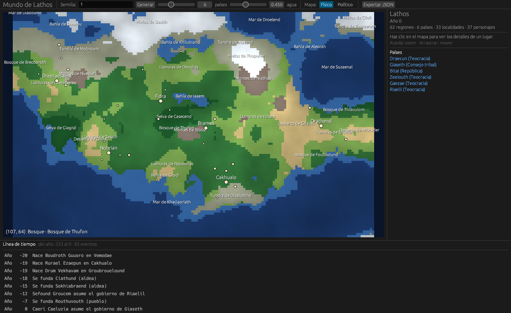

# WorldEngine

Aplicación en Rust para generar un mundo ficticio y simular su historia, como base
para escribir un libro, preparar una campaña de Dungeons & Dragons o simplemente
explorar. La inspiración es la generación de mundos y el modo Leyendas de
Dwarf Fortress.



## Cómo ejecutarlo

```sh
cargo run --release -p worldengine-app      # app visual
cargo run -p worldengine-core --example summary -- Arda   # resumen en terminal
cargo test --workspace
```

En Linux, la app necesita las bibliotecas de X11/Wayland y OpenGL habituales
(por ejemplo `libxkbcommon-x11-0` y `libgl1-mesa-dri`).

En la app: la **rueda** hace zoom, **arrastrar** mueve el mapa y un **clic** muestra
los detalles de la casilla (región, país, localidad, personajes e historia). La
semilla acepta números o texto: la misma semilla produce siempre el mismo mundo.
**Exportar JSON** guarda el mundo completo en el directorio actual.

## Estructura

| Crate | Contenido |
| --- | --- |
| `crates/core` (`worldengine-core`) | Modelo de datos, generación por etapas, consultas y serialización. Sin dependencias gráficas. |
| `crates/app` (`worldengine-app`) | Interfaz con `egui`: mapa físico y político, panel de detalles y línea de tiempo. |

El modelo se organiza por capas de detalle:

```
Mundo → Mapa (casillas: elevación, temperatura, lluvia, bioma, región, dueño)
      → Regiones → Países → Localidades → Personajes → Eventos
```

Todas las entidades se referencian por ids tipados (`RegionId`, `CountryId`, ...)
que son índices en las colecciones del `World`. Los eventos son la columna
vertebral de la historia: la línea de tiempo y el futuro modo Leyendas se
construyen a partir de ellos.

La generación (`crates/core/src/generate.rs`) corre por etapas, y cada una usa
su propio flujo aleatorio derivado de la semilla, para que cambiar una etapa no
altere a las demás: terreno → biomas → regiones → países y localidades →
personajes → eventos.

## Plan

1. **Base y modelo de datos.** Workspace, modelo, semilla reproducible, mundo de
   prueba y app con mapa y detalles. *(hecho)*
2. **Geografía y mapa.** Terreno más realista (placas, erosión, ríos, lagos),
   biomas y regiones con nombre, mejor zoom con más detalle.
3. **Civilizaciones e historia.** Simulación año a año: crecimiento, fundaciones,
   guerras, alianzas, sucesiones y muertes; territorios que cambian.
4. **Modo Leyendas.** Línea de tiempo deslizable que muestra el mapa en cada año,
   búsqueda de personajes, sitios y eventos, y exportación a crónica en texto.
